<div align="center">



<p>
  <a href="https://www.linkedin.com/in/deependra-kashyap-08aa74268"></a>
  <a href="https://x.com/CodeByDeependra"></a>
  <a href="https://www.instagram.com/crashed_deependra"></a>
  <a href="mailto:deependrakashyapp@gmail.com"></a>
  <a href="https://play.google.com/store/apps/details?id=com.dtools.allfileviewer"></a>
  
</p>

</div>

### `$ cat ~/about.yaml`

```yaml
name:      Deependra Kashyap
role:      Node.js Backend & Flutter Engineer
shipped:   10+ apps — Android, iOS and desktop, published on Google Play
backend:   REST APIs on Node.js + Express — auth, data modelling, file pipelines
mobile:    Flutter for Android & iOS, Kotlin when native speed matters
desktop:   Flutter on macOS, Windows & Linux
design:    API contracts, token auth, schema & index design, read-path performance
stores_in: [PostgreSQL, MongoDB, Firebase]
cares_about:
  - clean architecture that survives the next feature
  - performance you can measure, not just feel
  - code someone else can read in six months
learning:  [distributed systems, system design at scale, DSA]
goal:      "Build software that is fast, maintainable, and scalable."
```

<br/>

### `$ open system-design.svg`

<div align="center">

</div>

Half of my work is the client, half is the server it talks to. The top path is what makes **My Docs** fast on-device; the bottom path is the Node.js side: API design, auth and data modelling.

<br/>

### `$ cat design.md`

```text
api/        versioned REST (/api/v1) · one response + error envelope · async handler wrapper
auth/       short-lived JWT access token + refresh token · httpOnly, secure cookies · bcrypt
data/       schema and indexes designed first · aggregation pipelines for read-heavy views
files/      Multer → temp storage → Cloudinary · the database stores URLs, not blobs
clients/    offline-first on device · paginated, retry-safe calls over the network
scale/      stateless API instances · scale out behind a load balancer · cache hot reads
```

<br/>

### `$ ./stack --tree`

```text
.
├── backend/        Node.js · Express.js · REST · JWT · Mongoose · Multer · Cloudinary
├── data/           PostgreSQL · MongoDB · Firestore · Firebase Auth
├── system-design/  API design · auth flows · schema & indexing · caching · scaling
├── mobile/         Flutter · Dart · Kotlin · iOS · MethodChannels · Android SAF · ML Kit
├── desktop/        Flutter on macOS · Windows · Linux
├── state/          GetX · Provider · BLoC
├── patterns/       Clean Architecture · MVC · MVVM · Repository
└── tools/          Git · GitHub · Linux · VS Code · Postman · Google Play Console
```

<div align="center">
  
</div>

<br/>

### `$ git log --oneline projects/`

```text
f2b6a90  feat(youtube-backend):     Node.js + Express video platform API with JWT auth
a1f3e2d  feat(my-docs):             document viewer for Android, macOS, Windows & Linux
b7c9d41  feat(my-doctor-buddy):     patient–doctor healthcare app on Firebase
c3e8f05  feat(sonnet-sync):         API-driven poetry app with offline bookmarks
d9a2b16  feat(ai-chatbot):          multi-model Gemini assistant
e5f7c38  feat(infinite-wallpapers): infinite-scroll gallery with native wallpaper setting
```

<table>
<tr>
<td width="50%" valign="top">

#### 🎬 YouTube Backend — Video Platform API
[](https://github.com/Deependrakashya/youtube_backend)

`Node.js` `Express 5` `MongoDB` `Mongoose` `JWT` `Cloudinary`

- Versioned REST API (`/api/v1`) with a shared response/error envelope
- **Access + refresh token auth** in httpOnly cookies, bcrypt-hashed passwords
- Avatar and cover uploads: **Multer → Cloudinary**
- Channel profiles and watch history built with **MongoDB aggregation**

</td>
<td width="50%" valign="top">

#### 📄 My Docs — Document & File Viewer
[](https://play.google.com/store/apps/details?id=com.dtools.allfileviewer)
[](https://deependrakashya.github.io/MY-Docs-Releases/)

`Flutter` `Kotlin` `MethodChannels` `ML Kit` `Provider`

- Ships on **Android, macOS, Windows and Linux** from one codebase
- Excel/PDF processing offloaded to **background threads over MethodChannels**
- **On-device OCR** with Google ML Kit · **Android SAF** for policy-compliant file access
- UI stays responsive while the heavy work runs elsewhere

</td>
</tr>
<tr>
<td width="50%" valign="top">

#### 🩺 My Doctor Buddy
[](https://github.com/Deependrakashya/my_doctor_buddy)

`Flutter` `Dart` `Firebase Auth` `Firestore`

- Patient–doctor interaction layer on clean Flutter architecture
- **Firebase Auth + Firestore** for real-time, secure data flows
- Accessible, healthcare-oriented UI on Android & iOS
- Data model built to grow with new features

</td>
<td width="50%" valign="top">

#### 🎵 Sonnet Sync — Poetry App
[](https://github.com/Deependrakashya/sonnetSync)

`Flutter` `REST APIs` `GetX` `AdMob` `MVVM`

- API-driven architecture with **GetX** state management
- Dynamic search & filtering
- **Offline-first bookmarks** stored locally
- AdMob placed so it never gets in the way

</td>
</tr>
<tr>
<td width="50%" valign="top">

#### 🤖 AI ChatBot


`Flutter` `Gemini API` `REST APIs`

- **Multi-model Gemini** integration with context-aware responses
- API calls and rendering tuned for sub-100ms perceived latency
- Clean conversation state, responsive layout
- Modular, so new models slot in without rewrites

</td>
<td width="50%" valign="top">

#### 🖼️ Infinite Wallpapers
[](https://github.com/Deependrakashya/infinite_wallpapers)
[](https://github.com/Deependrakashya/infinite_wallpapers/releases/download/Release/app-release.apk)

`Flutter` `Dart` `GetX` `REST APIs` `MVVM`

- Infinite-scroll gallery across categorized collections (Anime, Nature, Abstract…)
- Home & lock-screen wallpaper setting through native integrations
- Optimized image loading, caching, and rendering

</td>
</tr>
</table>

<br/>

### `$ gh stats --user deependrakashya`

<div align="center">


<br/><br/>


<sub>Each point is one day's commits, PRs, issues and reviews · bottom axis is the day of the month, oldest on the left, today on the right</sub>

<br/>


</div>

<br/>

### `$ node philosophy.js`

```js
class DeependraKashyap extends SoftwareEngineer {
  role = 'Node.js Backend & Flutter Engineer';

  async build(problem) {
    const understanding = await this.understand(problem); // first, solve the problem
    const design = this.architect(understanding);         // then design the system
    const product = await this.implement(design);         // then write the code
    return this.measure(product).optimize();              // then make it fast
  }
}
```

<br/>

### `$ cat contact.json`

<pre>
{
  "linkedin":  "<a href="https://www.linkedin.com/in/deependra-kashyap-08aa74268">https://www.linkedin.com/in/deependra-kashyap-08aa74268</a>",
  "x":         "<a href="https://x.com/CodeByDeependra">https://x.com/CodeByDeependra</a>",
  "instagram": "<a href="https://www.instagram.com/crashed_deependra">https://www.instagram.com/crashed_deependra</a>",
  "email":     "<a href="mailto:deependrakashyapp@gmail.com">deependrakashyapp@gmail.com</a>",
  "status":    "open to Node.js backend &amp; Flutter work"   // say hi
}
</pre>



<div align="center">

<br/>

> *"First, solve the problem. Then, write the code."* — John Johnson

</div>
